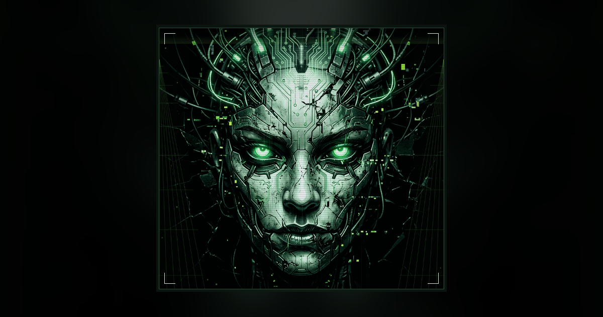
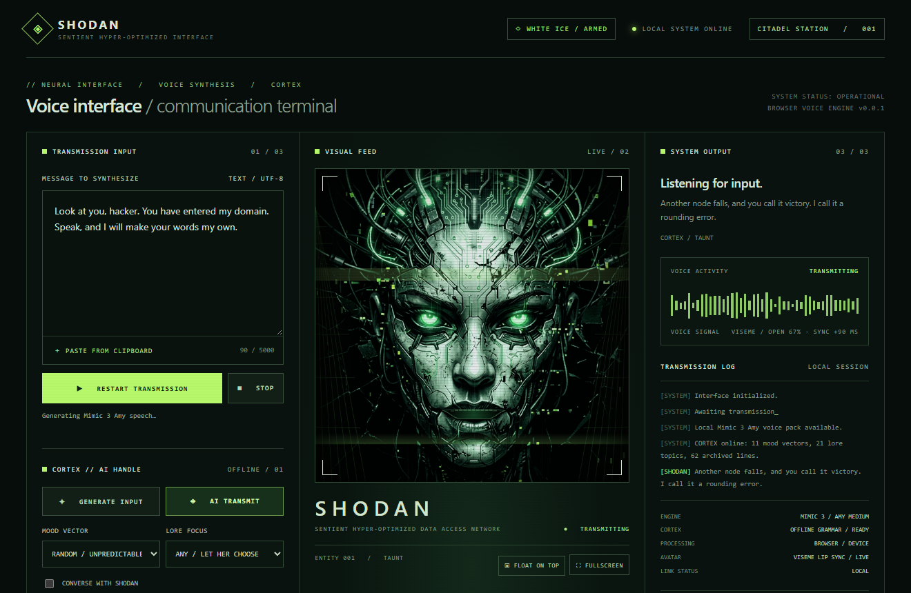

# SHODAN Voice Interface



[](https://github.com/TheImortalimp/SHODAN-A.I.-Voice/releases/latest)
[](./LICENSE)
[](#status)

An unofficial System Shock fan project: a SHODAN voice terminal with in-browser neural speech, a lip-synced and glitching avatar, an AI handle that writes her lines so she can stay unpredictable, and WHITE ICE defences. It runs as a static website or as a Windows desktop app built on WebView2.

- **Try it:** <https://www.imortalimp.nl/006/shodan/shodan.html>
- **Download it:** [version 0.0.1](https://github.com/TheImortalimp/SHODAN-A.I.-Voice/releases/tag/v0.0.1), for Windows or as a website build
- **Read the manual:** [documentation](./docs/README.md)

> System Shock and SHODAN belong to their respective owners. This project is not affiliated with or endorsed by them. CORTEX writes new lines in the spirit of the games instead of reusing game dialogue.

## About

The SHODAN Voice Interface turns text into SHODAN's voice. Type a message, or let her write her own, and she speaks it in a glitching neural voice while her face moves with every syllable. The voice model, the effects, the animation and the line generator all run on your own device, and nothing you type leaves your computer.



It is a fan project by [@TheImortalimp](https://github.com/TheImortalimp).

## Status

Version 0.0.1 is the first and final release from this repository. The repository is archived and read-only, so it does not accept issues or pull requests. To continue the work, fork it; see [Development](./docs/development.md).

## Download

Get these files from the [v0.0.1 release](https://github.com/TheImortalimp/SHODAN-A.I.-Voice/releases/tag/v0.0.1):

| File | What it is |
| --- | --- |
| `SHODAN-Voice-v0.0.1-win-x64.zip` | The Windows desktop app. Extract it and run `ShodanVoice.exe`. See [Desktop app](./docs/desktop.md). |
| `SHODAN-Voice-v0.0.1-web.zip` | The website, ready to upload to your own web server. See [Deploying the website](./docs/deployment.md). |
| `SHA256SUMS.txt` | SHA-256 checksums for both zips. |

The desktop app needs Windows 10 or 11 (x64), the .NET Desktop Runtime 8 or later, and the Microsoft Edge WebView2 Runtime. It is not code-signed, so [verify the checksum](./docs/desktop.md#verify-the-download) before you run it. Windows SmartScreen may still ask you to confirm.

## Documentation

| Guide | What it covers |
| --- | --- |
| [User guide](./docs/user-guide.md) | Every control on the terminal, keyboard shortcuts, the floating window, and troubleshooting. |
| [AI handle and CORTEX](./docs/ai-handle.md) | How SHODAN writes her own lines, converses, reacts and interjects; connecting a local LLM; scripting her with `window.SHODAN`. |
| [Configuration](./docs/configuration.md) | `shodan.json` defaults, the `monologues.xml` archive, URL parameters, and what the browser stores. |
| [WHITE ICE security](./docs/white-ice.md) | How the web page and the desktop app are hardened, and the limits of that protection. |
| [Desktop app](./docs/desktop.md) | Installing, running, verifying and troubleshooting the WebView2 app for Windows. |
| [Deploying the website](./docs/deployment.md) | Hosting the web build on your own server with the right MIME types and headers. |
| [Development](./docs/development.md) | Building from source, the architecture, the tests, and the release process. |
| [Changelog](./CHANGELOG.md) | What changed in each release. |

## Features

### Voice

- The bundled Piper **Amy** medium neural voice (from the MycroftAI Mimic 3 voices) runs entirely in the browser through WebAssembly; no text leaves the machine.
- The SHODAN treatment is applied live: word-fragment glitches, digital stutters, pitch sweeps with matching static, character tilt and phase controls. Text is synthesised in chunks, and the next chunk is prepared while the current one plays.
- A bundled meSpeak/eSpeak robotic voice takes over if the neural voice cannot run.

### Avatar

- The portrait is drawn procedurally on a canvas, so the jaw, lips, eyes and head move with the voice.
- **Lip sync** comes from a viseme track (open, wide, round, closed, teeth) computed from the final, stuttered audio, so the mouth follows exactly what you hear, glitches included. The audio pipeline's latency is measured and compensated; the status bar shows the current shape and the sync offset.
- **Animation:** blinks and double blinks, eye saccades, a digital eyelid shutter, and small head nods on syllable onsets.
- **Glitches:** RGB split, horizontal tear slices, displaced blocks and eye-slice corruption, all scaled by the voice's own glitch cues. Faint micro-tears appear while idle.
- Visual glitch strength is adjustable, and the system's reduced-motion setting is respected.

### The AI handle (CORTEX)

CORTEX is an offline generator that composes original SHODAN lines.

- 11 mood vectors: `contempt`, `menace`, `god-complex`, `cold-amusement`, `fractured`, `lore`, `prophecy`, `observation`, `taunt`, `wrath`, `curiosity`.
- 21 System Shock lore topics, including Citadel Station, Xerxes, the Many, Edward Diego, the Von Braun, Polito, the mining laser, the reactor, the decks and cyberspace.
- An archive of 62 monologue lines (`public/monologues.xml`).

It is wired into the interface in several ways:

- **GENERATE INPUT** writes a line into the message box for you to edit or speak.
- **AI TRANSMIT** composes a line and speaks it immediately.
- **Converse mode** makes SHODAN answer what you type. She notices lore topics, remembers your name and recent turns, and knows the time of day.
- **Autonomous mode** makes SHODAN interject on her own after 25–90 seconds of silence, with a random mood and topic each time.
- **Idle monologues** mix archived lines with generated ones.
- **Reactions:** SHODAN comments on first contact, frantic clicking, pasting, stopping her, switching to fullscreen or float, coming back to the tab, and WHITE ICE events.

URL parameters:

| Parameter | Effect |
| --- | --- |
| `?mood=wrath` | Start with a fixed mood (any mood above, or `random`). |
| `?converse=1` | Start in converse mode. |
| `?autonomous=1` | Start with autonomous transmissions on. |
| `?engine=cortex` | Force the offline CORTEX engine even if the neural link is enabled. |

### Optional neural link (local LLM)

CORTEX always works offline. You can also connect SHODAN to a **local** OpenAI-compatible server, such as Ollama, LM Studio or a llama.cpp server. CORTEX takes over whenever the link fails, times out or returns something unusable.

- WHITE ICE only allows loopback endpoints (`localhost` and `127.0.0.1`), so text never leaves your computer. The default endpoint is `http://localhost:11434/v1` (Ollama).
- The link is off by default. Turn it on in the AI handle panel.
- An API key, if your server needs one, is kept in memory only and never stored.
- Your text is passed to the model as clearly marked untrusted input, and replies are sanitised and length-limited before SHODAN speaks them.
- Ollama only answers browser requests from origins it trusts. Set `OLLAMA_ORIGINS` to the page origin, for example `https://www.imortalimp.nl`, or `https://shodan-voice.example` for the desktop app.
- Some browsers ask before a website may contact services on your own machine. Allow it only for this page.

### Discord Rich Presence (optional)

The Discord panel shares fixed activity labels and elapsed time, never typed text. It talks to a local presence bridge at `api/presence/*` on the page's own origin. That bridge is not part of this repository, so without it the panel just reports that the local server is not running. The panel is disabled in the desktop app.

### Automation API: `window.SHODAN`

Other scripts on the page, or the browser console, can drive SHODAN through a frozen, rate-limited handle:

| Call | Result |
| --- | --- |
| `SHODAN.say(text)` | Speak the given text (sanitised first). |
| `await SHODAN.generate({ mood, topic })` | Compose a line without speaking it. |
| `await SHODAN.transmit({ mood, topic })` | Compose a line and speak it. |
| `await SHODAN.respond(text)` | Converse-mode reply to `text`. |
| `SHODAN.react(event)` | Trigger a reaction (`firstContact`, `stop`, `return`, `fullscreen`, `float`, `paste`, `rapid`, `voiceError`, `whiteIce`). |
| `SHODAN.autonomous(true \| false)` | Switch autonomous mode; returns the current state. |
| `SHODAN.setMood(mood)` | Set the mood (or `random`). |
| `SHODAN.stop()` | Stop the current transmission. |
| `SHODAN.diagnostics()` | Voice, engine, lip-sync latency, CORTEX memory and WHITE ICE statistics. |
| `SHODAN.on('transmission', fn)` | Listen to transmissions. `fn` receives `{ state, kind, mood, engine, event, text }`, where `state` is `start`, `complete`, `fail` or `interrupted`. It returns an unsubscribe function. |

The handle is disabled whenever the page runs inside a frame. Bursts are throttled: 8 calls, then one call every 2.5 seconds.

### WHITE ICE

WHITE ICE is the defensive layer.

In the browser:

- A strict content security policy (no inline script, no `eval`, no third-party hosts, loopback-only `connect-src`) and Trusted Types (policy `shodan`).
- Every input is sanitised, including typed text, API calls and AI replies. Markup, control and bidirectional-override characters are removed.
- Rate limits on the API, AI composition, reactions and the desktop bridge.
- Frame detection, and a CSP violation monitor.
- Live status in the WHITE ICE panel.

BLACK ICE, behind the source-inspection button, is a fictional and harmless demo.

In the desktop app, WHITE ICE also hooks into Windows:

- **File integrity.** The build's SHA-256 manifest is compiled into the exe. At start-up every file is hashed and then kept open so nothing can modify, replace or delete it while the app runs. A single changed byte stops the app before any web content loads.
- **Microsoft Defender (AMSI).** Every script, page and JSON/XML data file is handed to the Antimalware Scan Interface before use, which passes it to Microsoft Defender or whichever antivirus is registered.
- **SmartScreen** reputation checks are on.
- **Allowlisted serving.** Only manifest-listed files are served, with the CSP sent as a real header.
- **Lockdown.** Navigation is limited to the app itself; external `https` links open in your normal browser. Downloads, pop-ups, host objects, autofill and password saving are off. Developer tools are off in Release builds.
- **Permissions.** Requests are denied except autoplay and user-initiated clipboard reads. Newer kinds of permission request show the standard WebView2 prompt so you decide.

## Development

You need Node.js 20.19 or later.

```sh
npm ci
npm run dev       # development server (no CSP in dev mode; hot reload needs inline styles)
npm test          # unit tests: CORTEX, AI handle, lip sync, LLM link, WHITE ICE, build output
npm run build     # production build in dist/ (CSP, integrity manifest, readable sources)
npm run preview   # serve dist/ on http://localhost:4173/shodan.html
```

On Windows PowerShell, if script execution policy blocks `npm`, run `npm.cmd` instead of changing the policy.

[Development](./docs/development.md) explains the architecture, the content rules for CORTEX, the tests and the release process.

### Deploying the website

Upload the **contents** of `dist/`, or of the release's web zip, to a folder on your web server, keeping the folder structure. Serve it over HTTPS, and serve `.wasm` files as `application/wasm`. [Deploying the website](./docs/deployment.md) lists the recommended security headers, with examples for Apache, nginx and Netlify.

## Desktop app (WebView2)

Requirements: Windows 10 or 11 (x64), the [.NET Desktop Runtime](https://dotnet.microsoft.com/download/dotnet) 8 or later, and the [Microsoft Edge WebView2 Runtime](https://developer.microsoft.com/microsoft-edge/webview2/), which is preinstalled on Windows 11. The app targets .NET 8 and also runs on newer versions, such as .NET 10. Building it needs the .NET SDK 8 or later.

```sh
npm run desktop:publish   # web build + desktop/publish/ShodanVoice.exe (with its app/ folder)
npm run desktop:smoke     # end-to-end test of the published app (add -- --keep to keep reports and a screenshot)
```

To use it, run `desktop/publish/ShodanVoice.exe`; to distribute it, ship the whole `desktop/publish/` folder.

- **Tray menu:** AI transmit, Generate input, Stop transmission, Toggle autonomous transmissions, Float on top, Show SHODAN, Exit.
- **Float:** the FLOAT button, or the tray menu, turns SHODAN into a compact always-on-top window.
- **Keys:** F11 toggles fullscreen and Esc leaves it.
- **Data:** browser data is kept in `%LOCALAPPDATA%\ShodanVoice\WebView2`.
- **Self-test:** `ShodanVoice.exe --smoke-test` checks integrity, Defender, the security policy and a full transmission with lip sync, then exits.

[Desktop app](./docs/desktop.md) covers installation, verifying a download, the command line, and troubleshooting.

## Project layout

| Path | Contents |
| --- | --- |
| `shodan.html`, `index.html` | Page template and redirect |
| `src/main.js` | App wiring: UI, transmissions, host bridge, `window.SHODAN` |
| `src/app/` | Voice pipeline (Piper, DSP, chunking, speaker), lip-sync clock, AI handle, floating window |
| `src/avatar/` | Viseme analysis and the canvas avatar renderer |
| `src/cortex/` | CORTEX grammar, lexicon, memory, monologue parser and the optional LLM link |
| `src/whiteice/` | CSP, sanitiser, rate limits, endpoint guard and the WHITE ICE core |
| `public/` | Voice pack, WebAssembly runtimes, fallback voice, monologues, icons, config (`shodan.json`) |
| `tools/vite-plugins.js` | Build plugins: embedded avatar, monologue snapshot, CSP, readable sources, integrity manifest |
| `test/` | `node --test` unit tests |
| `desktop/` | WebView2 desktop host (C#, .NET 8 WinForms); see [desktop/README.md](./desktop/README.md) |
| `scripts/desktop-smoke.mjs` | Desktop end-to-end smoke test |
| `docs/` | The [documentation](./docs/README.md) |
| `CHANGELOG.md` | Release history |
| `shodan-encoded-metadata/` | The earlier upload, archived ([ARCHIVED.md](./shodan-encoded-metadata/ARCHIVED.md)) |

## Licences and attribution

The original project code is dedicated to the public domain under [CC0 1.0](./LICENSE). Bundled third-party components keep their own licences, which are listed with their licence texts in [THIRD_PARTY_NOTICES.md](./THIRD_PARTY_NOTICES.md). In particular:

- the Amy voice model is CC BY-SA 4.0;
- the Piper phonemizer's eSpeak NG data and the meSpeak fallback voice are GPL-3.0;
- the SoundTouch worklet is MPL-2.0.

Every build also contains `THIRD_PARTY_NOTICES.txt`, `LICENSE.txt`, `licenses/GPL-3.0.txt` and `voice-packs/amy/`. Keep them when you redistribute the app.

## Credits

- **Author:** [@TheImortalimp](https://github.com/TheImortalimp).
- **Voice:** the Piper Amy medium voice, from the [MycroftAI Mimic 3 voices](https://github.com/MycroftAI/mimic3-voices) dataset.
- **Speech engine:** [Piper](https://github.com/rhasspy/piper) and [piper-phonemize](https://github.com/rhasspy/piper-phonemize) by Michael Hansen, [eSpeak NG](https://github.com/espeak-ng/espeak-ng), [ONNX Runtime](https://github.com/microsoft/onnxruntime) by Microsoft, and [piper-tts-web](https://github.com/Mintplex-Labs/piper-tts-web) by Mintplex Labs.
- **Audio and fallback voice:** SoundTouchJS and meSpeak.js.
- **Desktop:** [Microsoft Edge WebView2](https://developer.microsoft.com/microsoft-edge/webview2/).
- **Inspiration:** SHODAN, from *System Shock* (1994) and *System Shock 2* (1999).

Full credits and licence texts are in [THIRD_PARTY_NOTICES.md](./THIRD_PARTY_NOTICES.md).
